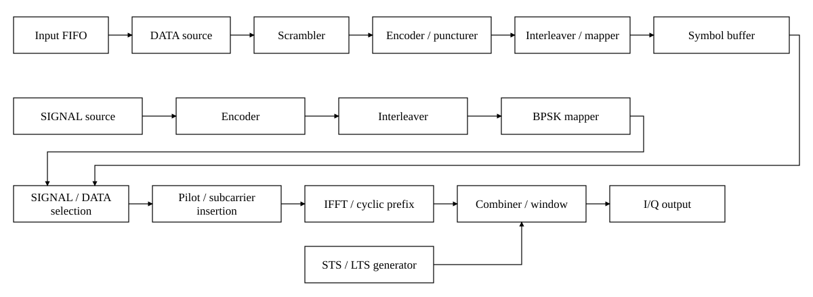

# Tx80211 — IEEE 802.11a/g OFDM Transmitter IP Core

`Tx80211` is a Verilog FPGA implementation of the IEEE 802.11a/g legacy OFDM transmit physical layer (IEEE 802.11 Clause 17). It converts MAC frames (PSDU) and a 24-bit `SIGNAL` configuration word into a 20 MS/s complex baseband waveform comprising the PLCP preamble (short and long training sequences), the `SIGNAL` symbol, and the `DATA` symbols.

- **Data rates:** 6, 9, 12, 18, 24, 36, 48, and 54 Mbps (BPSK, QPSK, 16-QAM, and 64-QAM with code rates 1/2, 2/3, and 3/4), switchable frame-to-frame without resetting the core.
- **OFDM parameters:** 64-point IFFT, 48 data subcarriers, 4 pilot subcarriers, 16-sample (0.8 µs) cyclic prefix, 80-sample (4.0 µs) symbol period, and symbol-boundary windowing.
- **Baseband output:** 20 MS/s signed 8-bit I/Q from the `transmitter` core (left-shifted to 16-bit in the `Tx80211_v1_0` wrapper) with a synchronous 20 MHz sample clock and frame-valid qualifier.
- **Verification suite:** Python golden TX/RX reference model (`model/wifi.py`) and Vivado `xsim` testbench verifying stage-by-stage bit exactness and full packet demodulation (~−34 dB output EVM, limited by 8-bit quantization).

## Architecture



An internal MMCM (`clock_gen`) derives a 120 MHz processing clock and a 20 MHz symbol/sample clock from the 100 MHz `clk` input, while a 2048-byte asynchronous input FIFO bridges the caller's write clock (`fifo_wr_clk` / `data_axis_aclk`). Running the `DATA` bit-processing pipeline at a fixed 120 MHz (480 cycles per 4 µs OFDM symbol) accommodates up to 216 raw bits and 288 coded bits per symbol at 54 Mbps without changing clock frequencies across rates.

For the `DATA` field, `data_source` reads `SERVICE` (16 zero bits) and `PSDU` bytes from the FIFO at up to one bit every two 120 MHz clocks and appends 6 tail bits plus pad bits to fill an integer number of OFDM symbols. `stream_scramble` applies the `S(x) = x^7 + x^4 + 1` frame scrambler and forces the 6 tail bits to zero at the encoder input to terminate the trellis. `stream_conv_encode` performs rate-1/2 convolutional encoding (`g0 = 0133`, `g1 = 0171` octal) and punctures the output to rate 1/2, 2/3, or 3/4 via valid enables. `stream_interleaver` and `stream_constellate` interleave and map each symbol into 48 complex subcarriers, which are transferred to the 20 MHz domain through a two-bank ping-pong buffer (`symbol_buffer`) read out once every 80 clocks (4 µs). The 24-bit `SIGNAL` field is processed by a parallel 20 MHz instance of the encoder, interleaver, and BPSK mapper.

In the 20 MHz domain, `stream_pilot_aboard` multiplexes the `SIGNAL` symbol and buffered `DATA` symbols, inserting the four pilots (with per-symbol LFSR polarity scrambling) and null subcarriers. `stream_ifft` executes a 64-point IFFT (`xfft`), prepends the 16-sample cyclic prefix, and applies saturating 8-bit quantization. Finally, `windowing_combiner` concatenates the ROM-based short and long training sequences (`training_seq_gen`) with the OFDM symbols and applies 0.5-weighted transition windowing at symbol boundaries.

## Interfaces

The core top level is `transmitter` (`rtl/Transmitter.v`). For Vivado block designs, `Tx80211_v1_0` (`rtl/Tx80211_v1_0.v`) wraps the core with an AXI4-Stream slave (`DATA_AXIS`, 64-bit `TDATA` using `TDATA[7:0]` per beat) for FIFO writes and an AXI4-Lite slave (`CTRL_AXI`) for control:

| Offset | Register | Description |
| --- | --- | --- |
| `0x00` | `CTRL_REG0` | `[23:0]`: `SIGNAL` word (`RATE[3:0]`, `LENGTH[16:5]`, even `PARITY[17]`); `[24]`: config valid strobe |
| `0x04` | `CTRL_REG1` | `[0]`: transmit trigger (`tx_now`), auto-cleared when `busy` asserts |
| `0x0C` | `CTRL_REG3` | `[0]`: `busy` status flag (read-only) |

Software pushes `SERVICE` (2 zero bytes) followed by `PSDU` (up to 2046 bytes) into the FIFO; hardware generates the tail and pad bits and drains any leftover FIFO bytes at frame end. For bare-metal Zynq + AD9361 integration, compile `sw/tx80211.c` and `sw/crc32.c` against the target board's Xilinx BSP and ADI no-OS driver; the transmit entry point is `tx_80211(phy, psdu, length, mbps)`.

## Repository layout

| Path | Contents |
| --- | --- |
| `rtl/` | Verilog RTL for the `transmitter` core and `Tx80211_v1_0` AXI wrapper |
| `sw/` | Bare-metal C driver (`tx80211.c`) and IEEE 802.11 FCS CRC-32 (`crc32.c`) |
| `sim/` | Vivado IP generation (`gen_ip.tcl`), testbench (`tb_tx80211.v`), and out-of-context synthesis/P&R scripts |
| `sim/ip/` | Xilinx IP configuration files (`xfft`, `fifo_generator`, `blk_mem_gen`, `clk_wiz`) |
| `model/` | Python golden TX/RX model (`wifi.py`), simulation checker (`harness.py`), and SDR capture decoder (`decode_capture.py`) |
| `docs/` | Architecture block diagram (`architecture.svg`) |

## Build and verification

Requires Vivado 2024.2 and Python 3 with NumPy (plus SciPy for capture resampling). Run from the repository root:

```sh
# 1. Upgrade and generate Xilinx IP simulation/synthesis models (once, into sim/ip_gen/)
vivado -mode batch -source sim/gen_ip.tcl

# 2. Run behavioral simulation and stage-by-stage verification
./run_test.sh rtl single --len 100 --mbps 54 --nframes 3
./run_regression.sh rtl
./run_multirate.sh rtl

# 3. Out-of-context synthesis and optional place-and-route (target: xc7z020clg484-1)
vivado -mode batch -source sim/check_synth.tcl
vivado -mode batch -source sim/check_impl.tcl
```

- `run_test.sh` generates stimulus matching `sw/tx80211.c`, runs `xsim`, compares the RTL outputs against `model/wifi.py` at every pipeline stage (scrambler, encoder, interleaver, mapper, pilots, and IFFT input), and demodulates the resulting waveform (`results/<name>/report.txt`).
- `run_multirate.sh` simulates 0-, 100-, and 1500-byte payloads across all eight rates (24 frames back-to-back without reset) and verifies zero internal `tx_valid` gaps and 100% frame recovery (`results/multirate/`).
- `check_synth.tcl` and `check_impl.tcl` constrain `clk` to 100 MHz and `fifo_wr_clk` to 125 MHz and write utilization, timing, and DRC reports to `results/synthesis/`.

To decode an over-the-air SDR recording (`cf32`, `ci16`, or `ci8`) with the reference receiver:

```sh
python3 model/decode_capture.py capture.cf32 --fmt cf32 --fs 20e6
```

## License

Copyright (C) 2019–2026 Tx80211 contributors. Distributed under the [GPL-3.0-or-later](LICENSE) license.

Xilinx IP output products, the Xilinx BSP, and Analog Devices no-OS drivers are not distributed in this repository; IP products are generated locally via `sim/gen_ip.tcl`.
